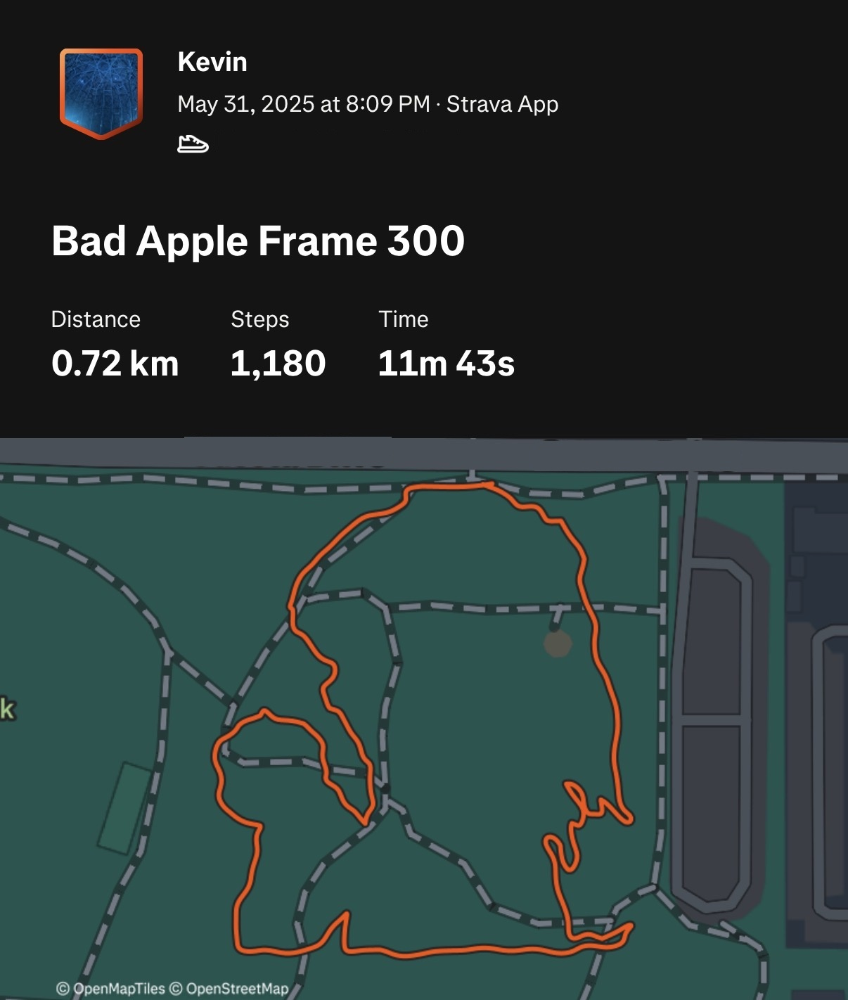

# badapple-strava

Making Bad Apple using Strava activities.

## How it works
The core technical challenge is to convert the video frames into something I can use to know where to walk.

In short, the core steps were:

1. Use opencv to find and select the contours of the shapes in the frame, yielding x, y coordinates of the points on the contour(s)
2. Choose a park to place those coordinates
3. Convert the x,y coordinates to UTM coordinates, which is like GPS but in a cartesian coordinate system
4. Convert to GPS coordinates
5. Export to GPX file, standard for import into exercise tracking apps

Then, to actually walk the route, I imported the GPX files into Gaia GPS, turned Strava on in the background, and then walked.
Strava actually couldn't handle direct import for me because their importer downsamples the GPX files too much.

## Files
I name the files of my public-facing projects with numbers because alphabetical order is usually just a big mess.

1. [`1_test_video_fps.py`](src/1_test_video_fps.py) to test what FPS would be good for the video. 2 fps was a good balance between continuity and number of frames to walk, though I eventually switched to 1 fps
2. [`2_single_frame_gpx.py`](src/2_single_frame_gpx.py) helps to find the right parameters to place a frame somwehere. I did this to make a path for me to walk in Toronto's downtown for my first frame.
3. [`3_bad_apple_to_gpx.py`](src/3_bad_apple_to_gpx.py) was an attempt to one-shot the bad apple to GPX conversion, but
the contours are not always proper (they don't always outline the correct shape, or enough shapes), so instead it was just a heuristic for the first pass and I took the results from that, stored it in a json file and used 4.
4. [`4_contour_editor.py`](src/4_contour_editor.py) is a simple Sreamlit webui I used to curate the contours chosen for each frame by adjusting the opencv
contour detection parameters manually. I was optimizing foro minimum distance, ensuring I was capturing the main subjects of every frame while ignoring the small specks. Output was curated json with xy coordinates of all the points along the contours.
5. [`5_json_to_gpx.py`](src/5_json_to_gpx.py) uses the json and the parameters from step 2 to convert the json to a gpx file. I imported these into Gaia GPS and walked them while tracking on Strava.
6. [`6_strava_scraper.py`](src/6_strava_scraper.py) scrapes the Strava API to get the data for the walks, including the polyline, which encodes the GPS data of the walk. I stored this all into a CSV file, which is gitignored because it has some activities near my house. Uses the [strava-client](https://github.com/GiovanniGiacometti/strava-client) package which I contributed to but also cloned locally to tune a bit.
7. [`7_parse_csv_to_json.py`](src/7_parse_csv_to_json.py) converts the csv into a JSON to use in the polyline renderer, keeping only the Bad Apple walks.
8. [`8_censor_strava_screenshots.py`](src/8_censor_strava_screenshots.py) helps me censor screenshots I took of all my Strava activities so I didn't have to doxx myself in my content until the end
9. [`9_screenshot_montage.py`](src/9_screenshot_montage.py) makes a montage of screenshots appearing in a collage style
10. [`10_screenshot_reel_vid.py`](src/10_screenshot_reel_vid.py) makes a reel of screenshots passing by like a film reel
11. [`11_video_data_pull.py`](src/11_video_data_pull.py) is a streamlit app to pull video data from Tiktok, Instagram, and Youtube. See [my article](https://medium.com/@kevinlinxc/fetching-your-view-counts-from-youtube-instagram-and-tiktok-python-72c121f1a9b1?sharedUserId=kevinlinxc) for a guide on how to use it.
12. [`12_image_stack.py`](src/12_image_stack.py) makes a stack of screenshots which was really engaging
13. [`13_rename_uncensored_screenshots.py`](src/13_rename_uncensored_screenshots.py) helped me preprocess the screenshots. Removes banners like "kudos on your 50th activity", renames the screenshots to a consistent format.
14. [`14_final_stack.py`](src/14_final_stack.py) combines all the processed screenshots into a final compilation with correct timing.

[polyline_renderer/](polyline_renderer/) is a nextjs app I made to visualize the polylines/other strava data from step 7, to make content with it. It also produces the final video that combines the polylines, the original bad apple video, distance/time data, and the screenshots of my Strava activities.

## How to run stuff

For the python scripts, install [uv](https://docs.astral.sh/uv/getting-started/installation/), run `uv sync`, then run `uv run src/<script_name>.py`. 

Some scripts also need [ffmpeg](https://ffmpeg.org/) (9, 10, 12, 14), [Tesseract](https://github.com/tesseract-ocr/tesseract) (8, 13) and Chrome (2, 3), plus credentials in a `.env` copied from [`.env.example`](.env.example).

For the polyline renderer, install [nodejs](https://nodejs.org/en/download/), change directory to `polyline_renderer`, and run `npm install` and `npm run dev` to run the app locally.